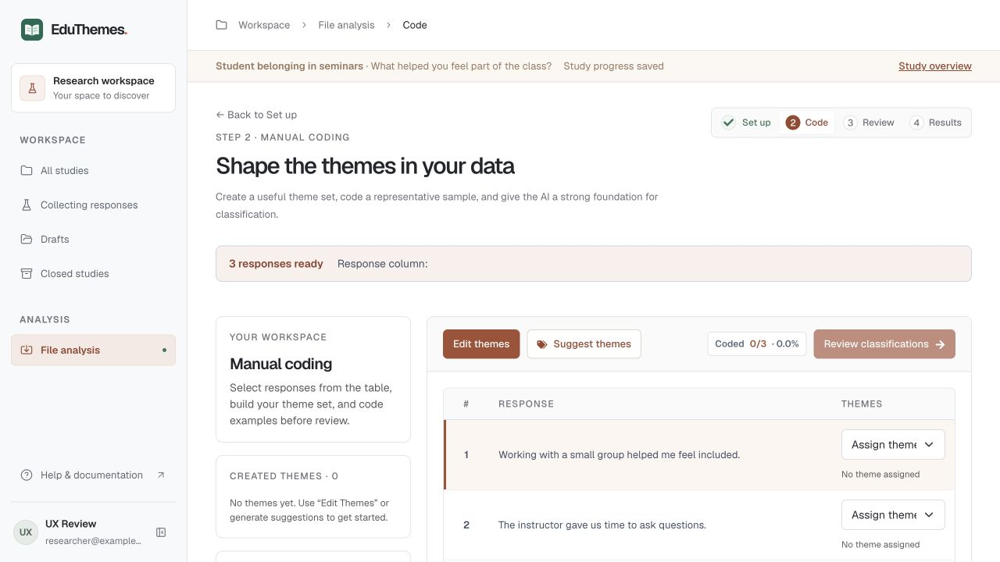
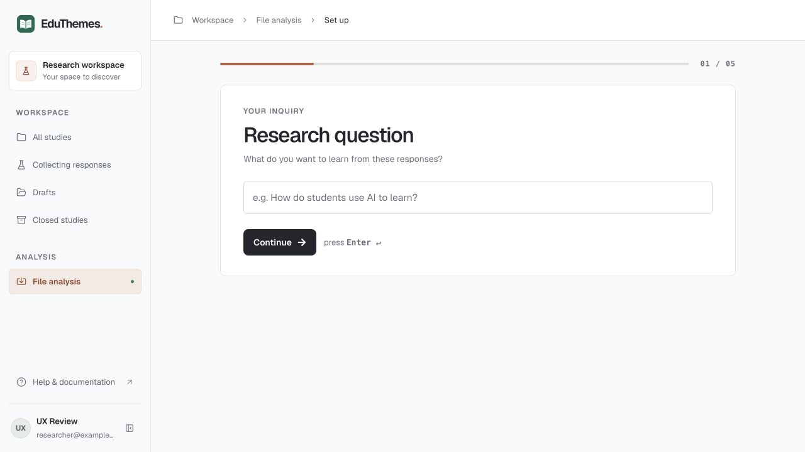

# Researcher app UX audit

October 31, 2026 · Baseline: 4545f11 · [Live researcher app](https://eduthemes-abepark.web.app/)

**Assessment**

The earlier redesign unified the appearance while leaving several interaction models underneath it. Study management, file import, manual coding, classification review, and findings each behave like a separate tool. Researchers repeatedly have to reconstruct which study, question, version, and set of responses they are working on.

The central change should be to make the study and its questions the permanent context. Navigation, saved work, progress, and next actions should follow that context throughout the app.

Two observed behaviors can discard research work. Fix those before expanding the redesign.

**How this was examined**

I inspected the authenticated live study library and an existing study, including collection metrics, saved findings, version controls, and team controls. I then walked through the current production frontend locally with fictional studies, identities, responses, and model outputs: sign-in, study creation, saving and editing drafts, starting coding, theme suggestions, manual assignment, classification review, rejection, unclassified responses, findings, restarting analysis, and leaving unsaved edits.

The local walkthrough used a synthetic API. The findings below distinguish reproduced frontend behavior from source-confirmed persistence or conditional behavior. The actual database save function was inspected to verify the overwrite mechanism. Model accuracy, production AI latency, large-dataset performance, and every collaborator permission combination were not tested. Publishing and invitations were inspected without changing live studies or sending invitations.

All screenshots in this report use fictional data. No production studies were changed. This is a heuristic audit and implementation review, not a usability study with representative researchers.

P1 means a priority correctness or task-continuity problem. P2 means substantial workflow friction. P3 means a supporting clarity or polish improvement.

**1. Selecting another response can erase a manual theme assignment — P1**

Reproduced locally:

1. Start coding with the first response selected.
2. Assign a theme to that response. The counter becomes “Coded 1 / 3.”
3. Select the second response.
4. The first assignment disappears. The counter returns to “Coded 0 / 3,” followed by “Study progress saved.”

The table updates the dataset, but the separately held selected response remains stale. Selecting another row writes that stale response back over the updated dataset. Autosaving then persists the changed dataset.

This damages the basic trust required to code research data. Selection must never modify coding. Use one authoritative response state and derive the selected response from it. Verify assignment, removal, selection, refresh, resume, and transition to review together.

Evidence: local reproduction and [selection behavior](/Users/abepark/Desktop/EduThemes/frontend/src/components/Preview.jsx:58), [stale response write](/Users/abepark/Desktop/EduThemes/frontend/src/components/Preview.jsx:97), and [analysis autosave](/Users/abepark/Desktop/EduThemes/frontend/src/App.jsx:200).

**2. Starting another analysis replaces completed findings before the replacement is finished — P1**

Reproduced locally: finish an analysis, return to the study and see “Findings saved,” select “Analyze current responses,” then return to the study. The question now shows “Coding in progress”; the previously displayed findings have gone.

The new run starts with a fresh codebook and dataset. Its first autosave sends null results into the same study/version/question record. The database updates that existing record rather than retaining a separate completed run. Revision checking prevents concurrent overwrites; it does not provide a browsable history.

Keep completed findings available while a new analysis is in progress. Offer distinct actions for continuing existing work and creating a new run. A new run should optionally reuse the codebook, identify its response snapshot, and become the current findings only when the researcher completes it. Earlier runs need a recovery/history path.

Moving backward from Results also sends null results to the saved record because saved results depend on the current screen. Navigation should not downgrade the durable research artifact.

Evidence: local restart reproduction, [analysis launch](/Users/abepark/Desktop/EduThemes/frontend/src/components/Researcher.jsx:176), [fresh run initialization](/Users/abepark/Desktop/EduThemes/frontend/src/App.jsx:180), [screen-dependent results save](/Users/abepark/Desktop/EduThemes/frontend/src/App.jsx:216), and [database replacement](/Users/abepark/Desktop/EduThemes/supabase/migrations/202610280001_teams_versions_consent.sql:399).

**3. Analysis leaves the study context, and “Back to Set up” goes somewhere misleading — P1**

Starting coding from a study changes the breadcrumb and active navigation to “File analysis.” The study and question survive in a separate banner, but the primary navigation describes a different task.

Selecting “Back to Set up” opens the file-import questionnaire at a blank research-question field. The study banner disappears. This does not necessarily erase the active dataset, but it makes the previous work appear disconnected and offers no direct return to that question on the setup screen. Recovery requires knowing to open File analysis and then Continue analysis.

The shared completed-step links make the same mistake. They suggest that setup can be revisited safely, but point to an unpopulated importer.

Give study analyses durable destinations within their study, question, and run. A study’s setup link should open its preserved dataset/context or study design. Imported datasets should use the same analysis structure with a lightweight project context. Keep researcher setup efficient and sectioned; reserve the slide-by-slide answering experience for participants.

Evidence: local reproduction, [breadcrumb and active navigation](/Users/abepark/Desktop/EduThemes/frontend/src/components/Header.jsx:75), [generic stage destinations](/Users/abepark/Desktop/EduThemes/frontend/src/components/WorkflowHeader.jsx:5), and [blank importer state](/Users/abepark/Desktop/EduThemes/frontend/src/components/Upload.jsx:25).

**4. The home screen inventories studies instead of helping researchers resume work — P2**

The sidebar, metric cards, and library tabs all repeat collection-status filters. The study cards then emphasize title, ownership, and creation date. They do not reveal where new responses arrived, which question is awaiting review, or where coding was left unfinished.

The useful “new since then” count already exists inside individual question cards. Promote that information to the study library and overview instead of requiring researchers to open each study and inspect every question.

Use compact study rows with collection status, response activity, analysis progress, last meaningful update, and one contextual action such as Continue review or Review new responses. Keep one clear filter system. Move introductory guidance into first-use or contextual help and remember search, sorting, and layout preferences.

Evidence: live and local library inspection, [library data fetched](/Users/abepark/Desktop/EduThemes/frontend/src/components/Researcher.jsx:99), [card information](/Users/abepark/Desktop/EduThemes/frontend/src/components/ResearchDashboard.jsx:44), and [existing question freshness count](/Users/abepark/Desktop/EduThemes/frontend/src/components/Researcher.jsx:240).

**5. Study details is an accumulation of features with weak task hierarchy — P2**

The page stacks enrollment operations, recruitment settings, draft editing, participation details, version history, responses, saved findings, and team management. The dominant header action on an open study is Close study. Sharing the study and working with its responses sit much farther down.

The apparent tabs are scroll anchors across this long page. They move the user rather than establish a stable working destination. Contextual navigation can disappear while the researcher is deep in the page.

Create stable study sections and keep the study title, selected version, collection status, and relevant primary action visible. The overview should summarize work and offer the next useful action. Design, collection, analysis, and team administration should each have a purposeful destination.

Evidence: live layout and navigation, [page composition](/Users/abepark/Desktop/EduThemes/frontend/src/components/Researcher.jsx:210), and [anchor navigation](/Users/abepark/Desktop/EduThemes/frontend/src/components/StudySectionNav.jsx:29).

**6. Enrollment and response counts create an apparent contradiction — P2**

On the live study I inspected, a collected submission appeared alongside zero enrollments and “Ready for the first enrollment.” A note explains that single-activity or historical submissions are tracked separately. The data can be correct while the experience still makes researchers question whether collection worked.

The operations panel appears before responses even when its enrollment model is not the relevant way to understand that study.

For a simple study, lead with collected submissions and question response counts. Show linked enrollments and activity completion when the study uses that participation model. Where both kinds of records exist, label their scopes directly and keep the explanation nearby. Do not imply that a study with collected responses is waiting for all participation to begin.

Evidence: live observation and [operations counts and explanation](/Users/abepark/Desktop/EduThemes/frontend/src/components/StudyOperations.jsx:64).

**7. Study creation has no distinct navigation destination, and unsaved edits are unprotected — P2**

Reproduced locally: while creating a study at the workspace root, clicking All studies leaves the creation form on screen. Creation is local component state at the same address as the study library.

Separately, editing an existing draft, changing its title, and opening File analysis leaves without a warning. Returning shows the old title and no recovered edit.

Give creation its own route and editing a predictable study destination. Preserve an unfinished private draft or warn before discarding changes. Show a truthful saved/unsaved state. Keep the current one-page, sectioned form and its direct Save draft action.

The existing single-page form is a useful foundation. The surrounding navigation and recovery behavior need the change.

Evidence: local reproductions, [creation replaces the library](/Users/abepark/Desktop/EduThemes/frontend/src/components/ResearchDashboard.jsx:31), [form state](/Users/abepark/Desktop/EduThemes/frontend/src/components/StudyForm.jsx:15), and [save/cancel controls](/Users/abepark/Desktop/EduThemes/frontend/src/components/StudyForm.jsx:91).

**8. Saving, publishing, and sharing lack a clear handoff — P2**

Saving a draft returns to a study page dominated by operations rather than preparation. Publication is a direct header action; there is no dedicated participant preview or consolidated readiness review in that flow. After publication, the code reports that the study is open, while the link-sharing controls remain elsewhere on the page.

Show a compact readiness checklist with direct links to incomplete sections. Include a participant preview that uses the real participant presentation without recording a response. After publication, surface the participant link, Copy link, identity mode, and the collection destination together.

This should remain fast for returning researchers: one sectioned editor, targeted readiness feedback, and a useful post-publication state.

Evidence: local draft-save handoff, live published-study controls, and [publication handling](/Users/abepark/Desktop/EduThemes/frontend/src/components/Researcher.jsx:143). Publication itself was not executed during this audit.

**9. Manual coding does not explain the point at which the researcher should hand over to AI — P2**

The page asks for a representative sample, then measures “Coded X / total” as a percentage. Review classifications becomes available after one assignment. The UI does not explain whether the goal is to code every response, establish examples for every theme, or prepare enough examples for a first classification pass.

“Review classifications” also initiates classification; it is not simply opening an existing review. “Suggest themes” opens a dialog that requires another Generate suggestions action.

Describe the next operation plainly: code examples, then classify the remaining responses. Show example coverage and theme definitions where coding happens. Provide sample guidance appropriate to the study without inventing a universal minimum. Add useful working controls such as search, uncoded filtering, and next response. Check these with larger datasets before deciding on pagination or virtualization.

Evidence: local walkthrough, [instruction and progress](/Users/abepark/Desktop/EduThemes/frontend/src/components/Preview.jsx:200), and [classification request](/Users/abepark/Desktop/EduThemes/frontend/src/components/Preview.jsx:170). Large-dataset usability remains a validation task.

**10. Review forces a sequence and changes the meaning of progress — P2**

Coding is organized around responses. Review switches to themes and requires moving through them sequentially. The theme list looks like navigation but is rendered as non-interactive items. A researcher cannot use it to jump back to an earlier theme.

Rejecting assignments produces another confirmation when advancing. At Unclassified, progress becomes 100% even when responses remain without a theme. Leaving a response unclassified can be legitimate, but “not yet resolved” and “deliberately left unclassified” are not clearly separated.

Make review a navigable work queue. Support theme and response views, pending/accepted/rejected filters, stable response references, and revisiting decisions. Report progress in explicit units such as assignments reviewed. Allow an intentional unclassified outcome and show it in the final review summary. Routine rejection should have inline feedback and undo instead of a repeated interruption at every theme.

Evidence: local review and rejection walkthrough, [sequential advancement](/Users/abepark/Desktop/EduThemes/frontend/src/components/Review.jsx:103), [non-interactive theme list](/Users/abepark/Desktop/EduThemes/frontend/src/components/Review.jsx:401), and [completion calculations](/Users/abepark/Desktop/EduThemes/frontend/src/components/Review.jsx:340).

**11. Findings have two different presentations and no strong route back to the next research task — P2**

The dedicated results screen provides Summary, Visualizations, and Theme List. The study page embeds another representation with findings text, counts, evidence disclosures, and a different download action. In the local walkthrough, Markdown headings rendered normally on the results screen and appeared as literal Markdown in the saved study view.

A completed question offers Analyze current responses rather than a prominent Open findings action. The results screen ends with Start a new analysis, which leads to the generic file-analysis workspace instead of the next question in the study. Summary and dataset exports are spread across different tabs.

Use one canonical findings destination per completed run. Study cards should summarize it and link to it. Keep theme evidence close to claims, identify the response snapshot, and provide one export menu with understandable formats. Offer Next question, Back to study analysis, and New run with new responses as contextual actions. Make saved findings and their presentation durable across sessions.

Evidence: local results/study comparison, [inline findings renderer](/Users/abepark/Desktop/EduThemes/frontend/src/components/Researcher.jsx:243), [Markdown results renderer](/Users/abepark/Desktop/EduThemes/frontend/src/components/Analyze.jsx:159), and [generic next action](/Users/abepark/Desktop/EduThemes/frontend/src/components/Analyze.jsx:304).

**12. Version context and collection lifecycle are harder to understand than the underlying data model — P2**

The selected published version lives in a side panel, while the breadcrumb says Study details. Analysis banners identify the study and question but omit the selected study version and response snapshot. Refresh resets the selected version to the current version.

Preparing a next version also requires closing the current study. The interface explains that the participant link will be paused, but preparing changes and closing new collection are tightly coupled.

Keep the selected version visible in the study header and throughout analysis. Preserve it during refreshes and make historical views unmistakable. Separate study version, response snapshot, and analysis run in the interface. Consider preparing the next draft while the current published version remains available; make any deliberate collection pause explicit.

The existing filtering is version-aware and published records are preserved. The problem here is orientation and lifecycle control.

Evidence: [view reset on load](/Users/abepark/Desktop/EduThemes/frontend/src/components/Researcher.jsx:123), [current version controls](/Users/abepark/Desktop/EduThemes/frontend/src/components/Researcher.jsx:213), and [analysis context banner](/Users/abepark/Desktop/EduThemes/frontend/src/App.jsx:324). These conditional version transitions were reviewed in source, not exercised on live studies.

**13. Accessing manual coding depends on AI availability — P2**

The study analysis entry path checks model availability before loading either fresh or saved coding. If the model is unavailable, the interface can expose an instruction to configure NAVIGATOR_API_KEY on the backend. A researcher generally cannot act on that message.

Load saved research work independently of AI availability. Restrict AI-dependent failures to suggestions and classification actions, keep manual work accessible where possible, and provide a useful retry path. Errors should explain the failed task and what remains available.

Evidence: [model availability gate and configuration error](/Users/abepark/Desktop/EduThemes/frontend/src/App.jsx:156). This is source-confirmed conditional behavior; the audit did not induce a production outage.

**14. Refresh and partial failures can disrupt the entire study workspace — P2**

The study load waits for study details, questions, submissions, analyses, versions, members, and role information together. Failure of any request clears the study. Successful reloads also reset version selection and exit editing.

A secondary panel failure should not routinely remove the whole authorized workspace. Load essential access information deliberately, scope secondary loading/error states to their panels, preserve the last valid content during refreshes, and retain the selected question/version and form edits. Authentication or permission failures still need appropriate access handling.

Continue using LoadingSkeleton for initial loads and scoped waiting states, shared Skeleton indicators with action labels and aria-busy for pending actions, and accessible/reduced-motion behavior. Distinguish actual empty states from loading and failure. The existing shared components are a foundation to retain.

Evidence: [combined loading, reset, and error handling](/Users/abepark/Desktop/EduThemes/frontend/src/components/Researcher.jsx:94). Partial-failure behavior was inspected in source rather than fault-tested against production.

**15. Supporting language and controls need to match actual tasks — P3, with an account-recovery gap**

The interface repeatedly introduces a workspace, a study workspace, a manual coding workspace, and a review workspace. Promotional guidance and large introductory blocks occupy space during repeat work. A workspace-switcher-shaped card has no switching interaction. Status wording also compresses both coding and review into Coding in progress.

Replace repeated introductions with compact context and specific work status. Use progressive help near complex choices. Make interactive-looking elements behave interactively or simplify their presentation. Keep routine account actions together and add a visible password-recovery path; the inspected sign-in screen offers sign-in and account creation but no recovery action.

Evidence: live/local screens, [sidebar presentation](/Users/abepark/Desktop/EduThemes/frontend/src/components/Header.jsx:73), [question stage wording](/Users/abepark/Desktop/EduThemes/frontend/src/components/Researcher.jsx:240), and [authentication form](/Users/abepark/Desktop/EduThemes/frontend/src/components/Researcher.jsx:15).

**Proposed organizing model**

Keep the study visible throughout its work. Within Analysis, the working object is a question, a study version, a response snapshot, and a saved analysis run. Collection status and analysis status should remain separate: an open study can have completed findings and a newer analysis in progress at the same time.

| Study destination | What belongs there | Primary question it answers |
| --- | --- | --- |
| Overview | Study status, preparation readiness, recent response activity, outstanding analysis work, concise links to findings | What needs my attention? |
| Design | One sectioned form for study details, participation, activities, questions, and participant preview | What will participants experience? |
| Collect | Participant link and sharing, incoming responses, and enrollment/activity operations when applicable | Are responses arriving, and who needs follow-up? |
| Analysis | Question work queue, saved runs, codebook, coding, review, and canonical findings | What am I analyzing, and where did I stop? |
| Settings | Team, permissions, full version history, and administrative actions | How is this study managed? |

Imported responses should enter the same analysis system through a lightweight project or an existing study. They should not require the full recruitment setup when that setup is irrelevant.

Within a question, the path should read: **Code examples → Classify remaining responses → Review assignments → Findings and evidence**. The context and saved run remain intact when moving backward or switching questions.

**Recommended order of work**

1. **Protect research work.** Fix the manual assignment overwrite; retain completed findings during a new run; make backward navigation safe; protect unsaved study edits. Add focused regression checks for these exact behaviors.
2. **Unify navigation and state.** Introduce stable study/question/run destinations, a persistent contextual header, a real creation route, predictable section navigation, and accurate saved/unsaved states.
3. **Join the handoffs.** Turn the library into a work queue, make the overview contextual, connect preparation to preview/publication/sharing, and connect incoming responses to question-level analysis.
4. **Improve the research workbench.** Clarify sample coding and classification, make review navigable, show explicit review units and unclassified outcomes, and consolidate findings and exports.
5. **Refine density and wording.** Reduce repeated promotional copy and decorative panels, improve contextual help and account recovery, and tune larger-dataset layouts after observing researchers use them.

**Acceptance checks for the redesign**

- Selecting another response never changes theme assignments.
- A completed findings page remains accessible while another run is unfinished.
- Back returns to populated, relevant context.
- A question analysis can be resumed from a durable link after reopening the app.
- Researchers can identify the study, version, question, response snapshot, stage, and saved state without leaving the workbench.
- New response counts and unfinished review are visible before opening every study.
- Simple response collection and linked enrollment totals have clearly different labels and appropriate prominence.
- Publishing leads directly to a usable sharing state.
- Review supports returning to an earlier theme and consciously leaving a response unclassified.
- Refresh retains the selected working context, and a secondary failure has a scoped error.
- A researcher can move from a completed question to the next question or an understandable export without entering the generic importer.

Validate the revised flow with task-based sessions: resume unfinished coding, find new responses, correct an earlier review decision, trace a finding to its response, prepare a follow-up version, and export findings. Watch for wrong turns, lost context, and uncertainty about whether work has been saved.
